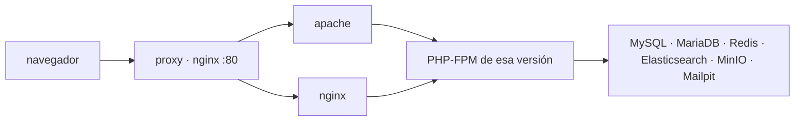

# LAR

Entorno local en Docker para sitios PHP. Cada sitio elige Apache o nginx y una versión de PHP. Los datos y la config viven en `data/` y se conservan al parar o actualizar.

## Petición

El proxy mira el dominio y pasa la petición a Apache o al nginx de ese sitio. Si el sitio tiene PHP, ese servidor llama al FPM de su versión. Si no, sirve HTML.

## Instalación

[INSTALL.md](INSTALL.md)

## Comandos

- `lar install` — prepara Docker y la config
- `lar init` — crea la config si falta
- `lar up` — arranca el entorno
- `lar down` — lo para, sin borrar datos
- `lar restart` — reinicia
- `lar status` — contenedores
- `lar logs` — últimas líneas de log
- `lar list` — sitios; flechas y enter abren uno
- `lar shell sitio` — shell de ese sitio (`lar -s sitio`)
- `lar update` — parches de la imagen PHP

`up`, `down`, `restart` y `logs` aceptan un servicio: proxy, apache, nginx, php, mysql57, mysql8, mariadb1011, mariadb101, elasticsearch, minio, redis, mailpit.

## Roadmap

- `lar backup`
- `lar restore`
- `lar upgrade`
