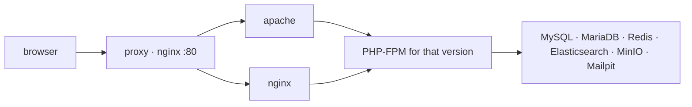

# LAR

**Lar** is Galician for home. It sits next to `home` and `localhost`: the machine where the projects run, old ones and new ones.

This is a Docker Compose stack of several containers, one local environment for all of them, old projects and new ones. It is meant for working with PHP, Node, and MySQL, among other things. I keep code from about twenty years of work, and I got tired of a different setup for each project. So this one is opinionated: the packages, the versions, and the way a site is laid out are the ones I want. The decisions are mine. The typing was done with AI.

It runs on a Mac. I have not tried it anywhere else. It might work on another machine with a few small changes to the install and the config.

[Install](INSTALL.md)

## What it does



One front nginx looks at the domain and sends the request to Apache or to that site's nginx. If the site has PHP, that server calls the FPM of the version the site asked for. If it does not, it just serves HTML.

All of PHP, from 5.6 to 8.5, lives in one machine. Around it: MySQL 5.7, MySQL 8, MariaDB 10.11 (`mariadb1011`), MariaDB 11.8 (`mariadb101`), Elasticsearch, MinIO, Redis, and Mailpit. `mariadb101` keeps that name, so the data folder and the hostname inside Docker stay the same. Your config and data stay in `data/` when you stop or update.

The PHP machine also has a few extra binaries I usually use. The set is opinionated: the ones I want in `lar shell`, so I do not install them on the Mac.

## Commands

| Command | What it does |
| --- | --- |
| `lar install` | Checks Docker, the port 80 helper, and the shared folders. Asks before it replaces your files |
| `lar init` | Creates `data/` and the config, only where something is missing |
| `lar up` | Starts the stack. On a Mac it writes the site domains into `/etc/hosts` |
| `lar up [service]` | Starts only that service. It does not change `/etc/hosts`. If a domain is missing, it prints the line to add |
| `lar down` | Stops everything and removes the hosts block. Your data stays |
| `lar down [service]` | Stops only that service. It does not change `/etc/hosts` |
| `lar restart` | Restarts the stack, or one service |
| `lar status` | Shows the containers |
| `lar logs` | Last log lines, or `lar logs php` for one service |
| `lar list` | Sites. Arrows to move, enter opens one |
| `lar shell site1` | zsh in that site, as `web`. `lar -s site1` is the same. `sudo su` gets you root |
| `lar update` | Looks for PHP, Chrome, and tool patches, and asks before applying them |
| `lar help` | Shows the help |

`up`, `down`, `restart`, and `logs` take one service: `proxy`, `apache`, `nginx`, `php`, `mysql57`, `mysql8`, `mariadb1011`, `mariadb101`, `elasticsearch`, `minio`, `redis`, `mailpit`. `mariadb1011` is MariaDB 10.11. `mariadb101` is MariaDB 11.8.

## A new site

Edit `data/config/sites.yaml`, then `lar up`. That rewrites the proxy, Apache or nginx, and the PHP pool. `init` will not overwrite this file once it has content.

```yaml
sites:
  site1:
    domain: site1.test
    alias:
      - site1.sandbox.test
    path: /absolute/path/to/the/project
    public_path: /absolute/path/to/the/project/public
    php: "8.4"
    server: apache
    node: "20"
    https: true
    xdebug: coverage
    memory_limit: 1536M
```

| Key | What it does |
| --- | --- |
| `domain` | The name you open in the browser, usually `something.test` |
| `alias` | More domains for the same site, one per line under `alias:` |
| `path` | The project folder, an absolute path. `lar shell` opens here |
| `public_path` | What Apache or nginx serve. Absolute, or relative to `path`, like `public`. Skip it and the whole `path` is served |
| `php` | `"5.6"` through `"8.5"`. Skip it and the site is static HTML |
| `server` | `apache` or `nginx`. Skip it and you get Apache |
| `node` | Node for that shell, like `"20"` or `"14.15.0"`. The machine has 14.15.0, 19.1.0, 20.0.0, and 22.21.1 |
| `https` | `true` makes a self-signed cert for the domain and its aliases, and serves it on 443 |
| `xdebug` | `false` off, `true` debug on port 9003, `coverage` for Codeception, `debug,coverage` for both |
| `enabled` | `false` leaves the site out |
| any other ini key | Applied only to that site, if that key exists in the ini of its PHP. Example: `memory_limit: 1536M` |

## Roadmap

New commands to add:

- `lar backup`
- `lar restore`
- `lar upgrade`

---

<br><br><br>

<p align="center">
  
</p>
