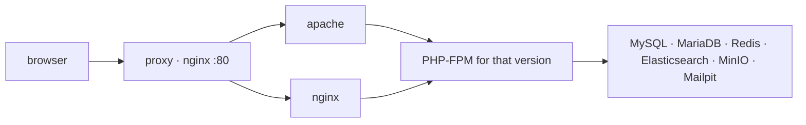

# LAR

Local Docker environment for PHP sites. Each site chooses Apache or nginx and a PHP version. Data and config live in `data/` and stay when you stop or update.

## Request

The proxy looks at the domain and forwards the request to Apache or to that site's nginx. If the site has PHP, that server calls the FPM for its version. Otherwise it serves HTML.

## Installation

[INSTALL.md](INSTALL.md)

## Commands

- `lar install` — prepares Docker and the config
- `lar init` — creates the config when it is missing
- `lar up` — starts the environment
- `lar down` — stops it, without deleting data
- `lar restart` — restarts
- `lar status` — containers
- `lar logs` — latest log lines
- `lar list` — sites; arrows and enter open one
- `lar shell site` — shell for that site (`lar -s site`)
- `lar update` — patches for the PHP image

`up`, `down`, `restart`, and `logs` accept one service: proxy, apache, nginx, php, mysql57, mysql8, mariadb1011, mariadb101, elasticsearch, minio, redis, mailpit.

## Roadmap

- `lar backup`
- `lar restore`
- `lar upgrade`
